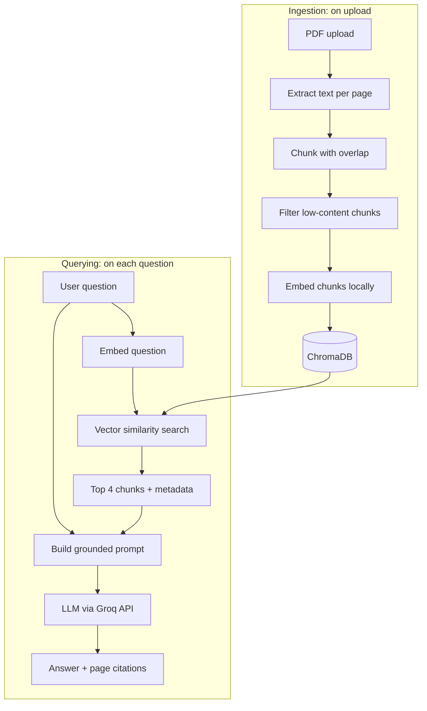

# DocChat: Document Q&A with RAG

Upload PDFs and ask questions about them. Answers are generated **only from your documents** and come with the **exact page numbers** they were taken from. If the answer isn't in the document, the app says so instead of making something up.


> Built from scratch: the chunking, retrieval and prompt-grounding logic is hand-written, with no LangChain or LlamaIndex.


## Features

- **PDF upload** with drag and drop, indexed in seconds
- **Semantic search**: finds relevant passages by meaning, not just keywords
- **Grounded answers**: the LLM is instructed to use only the retrieved context and to decline out-of-scope questions
- **Page-level citations**: every answer links to the source passages (filename, page, text)
- **Multi-document support**: search across all files or restrict to one
- **Document management**: list and delete uploaded files
- **React chat UI** with typing indicator, suggested questions, collapsible sources and dark mode

---

## How it works

The system has two separate flows: **ingestion** (once per document) and **querying** (every question).



1. **Extract**: text is pulled from each PDF page separately, so every chunk knows its page number.
2. **Chunk**: each page is split into 200-word chunks with a 40-word overlap, so ideas that span a boundary aren't lost.
3. **Filter**: chunks under 15 words (title-only slides, near-empty pages) are dropped, because they match queries on keywords but carry no information.
4. **Embed**: each chunk becomes a 384-dimensional vector using `all-MiniLM-L6-v2`, running locally with no API cost.
5. **Store**: vectors, text and metadata (`source`, `page`) go into a persistent ChromaDB collection.
6. **Retrieve**: the question is embedded with the same model, and the 4 nearest chunks are fetched, optionally filtered to one document.
7. **Generate**: the chunks and question go into a prompt that restricts the model to the given context and asks for `[n]` citations. The LLM runs on Groq.

---

## Tech stack

| Layer | Technology |
|---|---|
| Frontend | React (Vite), plain CSS |
| Backend | Python, FastAPI, Uvicorn |
| PDF parsing | pypdf |
| Embeddings | sentence-transformers (`all-MiniLM-L6-v2`) |
| Vector database | ChromaDB (persistent, local) |
| LLM | `openai/gpt-oss-20b` via the Groq API |

---

## Design decisions

- **Per-page chunking.** Chunking the whole document at once loses page information. Chunking per page makes real citations possible.
- **Low-content filtering.** In testing on a slide-deck PDF, title-only slides such as "Need of Blockchain" were being retrieved as top results because they matched on keywords. They wasted retrieval slots, so chunks under 15 words are now skipped.
- **Same embedding model for ingestion and querying.** Vectors from different models aren't comparable, so the model is defined once and shared.
- **Models load once at startup**, not per request, so each question doesn't pay the model-loading cost.
- **`upsert` instead of `add`.** Re-uploading a file updates its chunks instead of crashing on duplicate IDs.
- **Metadata filtering.** ChromaDB's `where` filter restricts a search to one document without a separate index.
- **Grounding in the prompt.** The model is told to answer only from the context and to say "I couldn't find that in the document" otherwise. The UI hides the retrieved sources in that case, since they would only be nearest-neighbour noise.

---

## Getting started

### Prerequisites

- Python 3.10+
- Node.js 20+
- A free [Groq API key](https://console.groq.com)

### 1. Clone the repo

```bash
git clone https://github.com/<your-username>/<your-repo-name>.git
cd <your-repo-name>
```

### 2. Backend

```bash
python -m venv venv

# Windows
venv\Scripts\activate
# macOS / Linux
source venv/bin/activate

pip install -r requirements.txt
```

Create a `.env` file in the project root (see `.env.example`):

```
GROQ_API_KEY=your_key_here
```

Start the server:

```bash
uvicorn main:app --reload
```

The API runs at `http://127.0.0.1:8000`, with interactive docs at `/docs`. The first run downloads the embedding model (about 90 MB, once).

### 3. Frontend

In a second terminal:

```bash
cd frontend
npm install
npm run dev
```

Open the URL it prints (usually `http://localhost:5173`).

---

## API reference

| Method | Endpoint | Description |
|---|---|---|
| `POST` | `/upload` | Upload a PDF (multipart form, field `file`). Returns filename, page count and chunks stored. |
| `GET` | `/documents` | List uploaded documents. |
| `DELETE` | `/documents/{filename}` | Remove a document and all its chunks. |
| `POST` | `/ask` | Ask a question. Body: `{"text": "...", "filename": "optional.pdf"}`. Returns the answer and sources. |

Example response from `/ask`:

```json
{
  "question": "What is blockchain?",
  "answer": "A blockchain is a distributed ledger that records transactions in a chain of blocks... [1][2]",
  "sources": [
    { "text": "...", "source": "BLOCKCHAIN UNIT 2.pdf", "page": 4 },
    { "text": "...", "source": "BLOCKCHAIN UNIT 2.pdf", "page": 5 }
  ]
}
```

---

## Project structure

```
.
├── main.py              # FastAPI app: ingestion, retrieval, generation
├── requirements.txt
├── .env.example
└── frontend/
    ├── index.html
    ├── package.json
    └── src/
        ├── App.jsx      # Chat UI, upload, document list
        └── index.css
```

---

## Known limitations

- Works on text-based PDFs only. Scanned PDFs need OCR, which isn't included.
- Each question is answered independently, with no conversation memory.
- Retrieval is vector-only, so exact-term matches (IDs, acronyms) can be missed.
- All uploads share one collection, with no per-user separation or authentication.
- CORS is open (`*`) for local development and should be restricted before any deployment.

## Roadmap

- [ ] Retrieval evaluation: a labelled question set to measure hit rate and compare chunk sizes
- [ ] Hybrid search (BM25 + vectors) with reranking
- [ ] Streaming responses
- [ ] Conversation memory for follow-up questions
- [ ] Docker setup and deployment
- [ ] Automated tests and CI

---

## License

MIT
